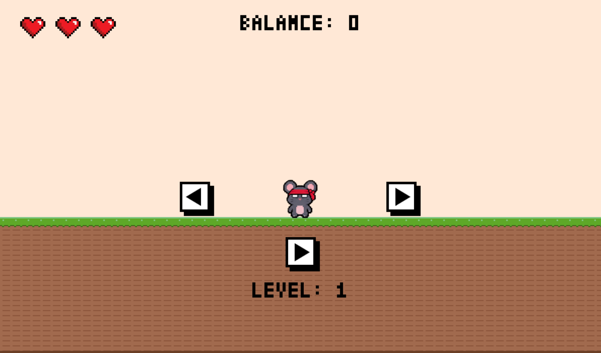
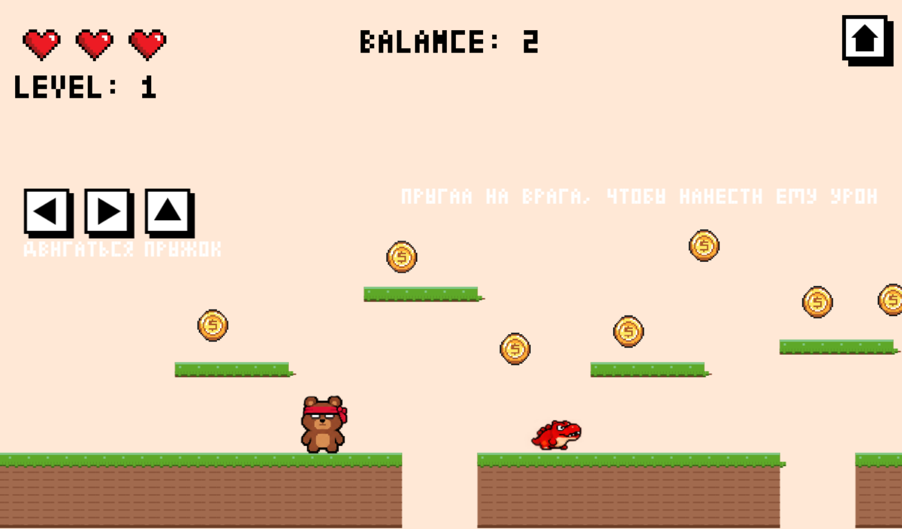
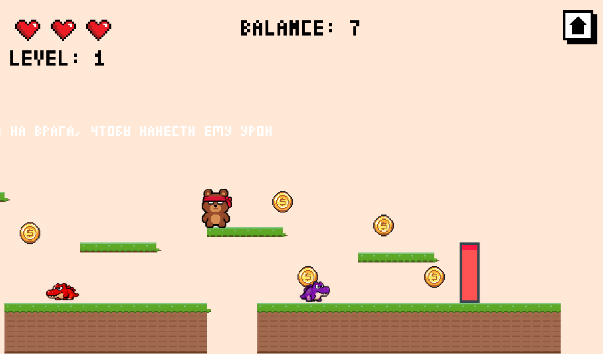
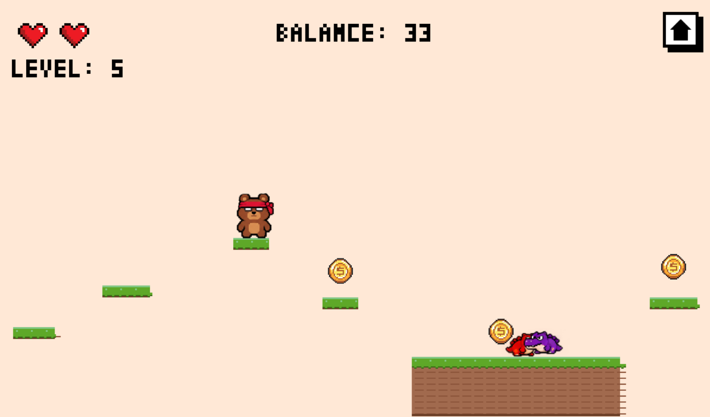

# Пиксельный платформер
Это браузерная игра, написанная на JavaScript. 

##  Особенности игры
* **5 уникальных уровней** с возрастающей сложностью.
* **5 игровых персонажей** на выбор.
* **Враги** которых можно побеждать, прыгая им на голову.
* **Система сбора монет** и подсчет.

---

## Видео геймплея

[https://github.com/dariank/game-platformer/assets/game.mp4](https://github.com/user-attachments/assets/92db0969-4e0d-47d0-8291-d24dc13e60d4)

---

## Скриншоты

  
  
   
  
  

## Как запустить игру локально

1. Скачай все файлы проекта.
2. Убедись, что все картинки (`spritesheet.png`, `enred_right.png`, `coin.png` и т.д.) лежат в той же папке, что и `index.html`.
3. Открой файл `index.html` в любом браузере (Chrome, Firefox, Edge).
